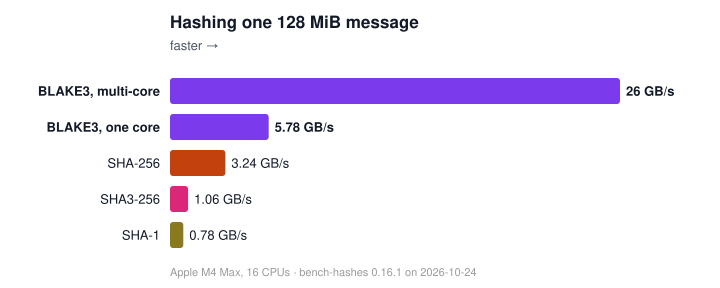

# bench-hashes

Written by AI at Zooko's request and to his specifications.

## Is BLAKE3 faster than SHA-256?

It depends. Try it! bench-hashes measures the hashes on your computer,
for each way a program hashes, and draws the answer as a map you open in
a web browser.



[The overview](https://johnservil.github.io/bench-hashes/) is one page
for every machine measured: a column per machine, a row per way a program
hashes, and in each row the hashes' speeds as bars, with how many times
faster the fastest ran. Every size, on each machine measured so far:

- [Apple M4 Max, macOS](https://johnservil.github.io/bench-hashes/benchmark-results/AppleM4Max.darwin25/bench-hashes.map.html)
- [AMD EPYC 9255, Linux](https://johnservil.github.io/bench-hashes/benchmark-results/AMDEPYC925524CoreProcessor.linux70038generic/bench-hashes.map.html)
- [Intel i7-12700K, Linux](https://johnservil.github.io/bench-hashes/benchmark-results/12thGenIntelRCoreTMi712700K.linux70038generic/bench-hashes.map.html)
- [A Linux VM on that Mac](https://johnservil.github.io/bench-hashes/benchmark-results/aarch64.linux618520virt/bench-hashes.map.html)

## Run it on your computer

You need [Rust](https://rustup.rs) and a C compiler: Xcode's command-line
tools on macOS (`xcode-select --install`), gcc or clang on Linux, or the
Visual Studio C++ build tools on Windows. Then:

```sh
git clone https://github.com/johnservil/bench-hashes
cd bench-hashes
cargo run --release
```

To measure a released version, so that others can compare their results
with yours, check out its tag first: `git checkout` followed by a tag
that [Releases](https://github.com/johnservil/bench-hashes/releases)
lists.

The first build takes a minute or two; the run then measures for about
a minute and needs about 1 GB of free memory. The numbers come out most
accurate when nothing else busy runs on the computer meanwhile.

## Read your results

The run writes these files to `benchmark-results/`, in a folder named after
your CPU and operating system:

- `bench-hashes.map.html`: the map. Open it in a web browser.
- `bench-hashes.chart.svg`: one 1 MiB message as bars, a picture to share
  (a full run draws it; `bench-hashes chart` draws it again from a
  samples file).
- `bench-hashes.result.txt`: the same numbers as text tables.
- `bench-hashes.samples.tsv`: every single measurement, for your own
  analysis.

The map has a small chart for each way a program hashes. Its rows say
what the program hashes:

- one message;
- a batch of 64-byte messages (a Merkle tree's nodes);
- many messages at once, arriving in pieces (a server's uploads);
- a collection of messages of every size (a repository's objects, a
  store's files);
- a message with its outboard, for verified streaming, and a message
  received in that form, verified as it arrives.

Its columns say how the program calls: now and then, *after other work*
or *after a pause*, and nonstop, *waiting for each call* or
*pipelined*. Point at a row's or a column's name, or tap it, to see
what it means. Open a chart to read its values under the pointer or
where you tap; a hash's name hides or shows its lines; each call's name
links to its documentation.

Each library keeps one colour, its multi-threaded form drawn as a double
line. At a chart's right end a bracket joins BLAKE3 servil's line (the
faster of its forms shown) and its strongest rival's, and says how many
times faster the winner ran, in the winner's colour.

The bar at the top stays in view as you scroll. Its switch shows each
hash as a rate, knob up (bytes per second: higher is better), or as a
cost, knob down (nanoseconds per byte: lower is better). Its chips choose
what a line's height counts: per second the program waits (solid, the
default), per second of processor time across all its threads (dotted),
or per joule the CPU package used (dashed, where the computer counts
energy). A hash on one thread draws its first two together; a
multithreaded one shows here what its speed costs the machine. An opened
chart's values say where the program's thread ran (performance or
efficiency cores, and at what clock).

Under each section's title the map says where and when the run was made,
and whether other programs kept the computer busy; "About this run" says
the rest, the power source among it. If programs were busy, or the
computer ran on battery, run again quieter and plugged in: busy programs
slow the results, and battery power changes which cores run them.

The contenders:

- **BLAKE3 servil mt**: [`blake3-servil`](https://github.com/johnservil/BLAKE3),
  faster than official BLAKE3 on 64-bit Arm (above all on Apple M4-class
  chips) and on x86-64, with its own threads to spread large inputs over
  your CPU cores and a stream for inputs that come one after another.
- **BLAKE3 servil st**: the same on one thread.
- **SHA-256** (the `sha2` crate) and **SHA-256 ring** (the `ring`
  crate): SHA-256 with the CPU's SHA-256 instructions where it has them;
  two implementations, since each is fastest at some sizes on some
  computers.

`cargo run --release -- --all` adds the official BLAKE3 crate, SHA3-256,
SHA-1DC, and Apple's CommonCrypto SHA-256; it takes longer. `--contenders` picks any set by name, among them the official
crate on its thread pool (`blake3-official-mt`), which runs only when
named (`--list` shows the names).

## Which function to use

The servil crate's documentation has a table, "Which call to use", that
leads from what a program hashes to one call:
https://johnservil.github.io/BLAKE3/blake3_servil/. The map's rows are
the same cases, so each row's chart shows that call's measured speed here.

## How fast is b3sum?


`bench-hashes b3sum` times builds of `b3sum`, the BLAKE3 command-line
tool, as you run it: each run a new process, from its start to its exit.
It hashes fixed files from 4 KiB to 1 GiB and two directory trees, with
the files in the page cache (read moments before) and, on Linux and
macOS, evicted from it before each run (read from storage):

    python3 tools/b3sum-contenders.py /path/to/BLAKE3-fork /tmp/b3c |
        tr '\n' '\0' | xargs -0 cargo run --release -- b3sum --files ~/b3sum-files

A contender is `NAME=COMMAND`, a `b3sum` and its flags, or any program
that hashes the files it is given (the files are appended);
`tools/b3sum-contenders.py` builds official BLAKE3's `b3sum` 1.8.2 and
the fork's at given commits, and adds the system's `sha256sum`, `sha1sum`
and `md5sum`, the programs a user chooses between. The first contender
is the one the others are compared with. `--files` chooses where the files live:
put them on the storage you care about (they are made once, 1.4 GiB, and
kept). `--quick` runs a smaller set in seconds. The report and samples go
to `benchmark-results/`, as `b3sum.result.txt` and `b3sum.samples.tsv`,
and the map there gains a b3sum section: a file or a tree of files, in
the page cache or read from storage. `bench-hashes compare` reads the
samples as it reads the hashes'; `bench-hashes map FOLDER` draws a
folder's map again from its samples files.

`bench-hashes map NEW_FOLDER --beside OLD_FOLDER` compares two runs side
by side in `bench-hashes.beside.map.html`. Each chart draws the older
run's lines dashed under the newer run's, and the values under the
pointer say how many times faster each hash runs now. The releases'
comparisons are in [`beside/`](beside/).

The maps above hold b3sum's results too: official b3sum beside the
fork's.

## Share your results

Your map is one self-contained file. Post it and `bench-hashes.result.txt`
anywhere people can download them: an issue, a gist, a forum. Anyone who
opens the map in a browser sees it as you do.

Or publish them on the web from your own copy of this repository, as the
results above are:

1. On GitHub, fork `johnservil/bench-hashes`. If you cloned it before
   forking, point your clone at your fork:
   `git remote set-url origin https://github.com/YOU/bench-hashes`
2. Commit your results and push them:
   ```sh
   git add benchmark-results
   git commit -m "Results for my computer"
   git push
   ```
3. On GitHub, in your fork's Settings, under Pages, choose "Deploy from a
   branch", the branch `main`, and the folder `/ (root)`.

A minute later your map is at
`https://YOU.github.io/bench-hashes/benchmark-results/FOLDER/bench-hashes.map.html`,
where FOLDER is the folder the run created.

We would be glad to add your results to ours: once they are pushed to
your fork, open a pull request to `johnservil/bench-hashes` on GitHub.
Say in it what computer you ran on. Results from a machine we already
have go beside ours, so rename your folder first,
for example
`git mv benchmark-results/AppleM4Max.darwin25 benchmark-results/AppleM4Max.darwin25.yourname`.

## More

`cargo run --release -- --help` lists the other options, such as more
BLAKE3 and SHA implementations. [METHODOLOGY.md](METHODOLOGY.md) explains
how bench-hashes measures, and what each contender runs. To race your own
hash against these, [CONTRIBUTING.md](CONTRIBUTING.md) says how to add
it.
